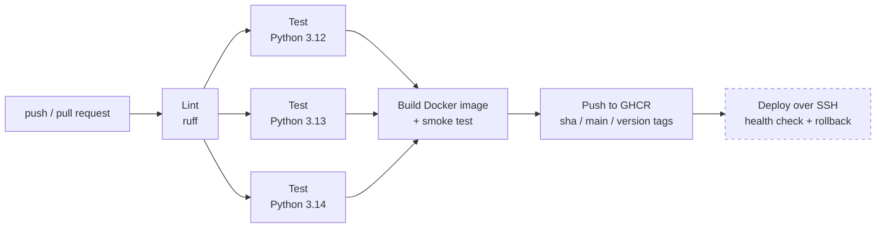

# Ghana PAYE API: a GitHub Actions CI/CD pipeline

[](https://github.com/buildwithmoi/ghana-paye-api/actions/workflows/ci-cd.yml)

A small API that calculates Ghana's monthly **PAYE** and employee **SSNIT** contribution, used here to show a complete, production-style **CI/CD pipeline** in GitHub Actions. Every push is linted and tested. Every commit to `main` becomes a tested Docker image in GitHub Container Registry and can be deployed to a Linux server over SSH, with a health check and automatic rollback.

The pipeline is all in one commented file: [`.github/workflows/ci-cd.yml`](.github/workflows/ci-cd.yml).

## The pipeline



| Job | What it does | Runs on |
|---|---|---|
| **Lint** | `ruff check` and `ruff format --check` | every push and PR |
| **Test** | `pytest` on Python 3.12, 3.13 and 3.14 in parallel; results uploaded as artifacts | every push and PR |
| **Build & publish** | Builds the image, **starts it and calls `/health` and `/paye`**, then pushes it to `ghcr.io` | pushes to `main` and `v*` tags (never PRs) |
| **Deploy** | Copies the compose file to the server, pulls `sha-<commit>`, waits until `/health` reports that exact commit, and **rolls back** to the previous image if it doesn't | `main`, once a server is configured (dashed in the diagram) |

### Choices worth pointing out
- **Least-privilege tokens.** The workflow can only read the repo by default. Only the build job gets `packages: write`, and only to push the image. The registry login uses the short-lived `GITHUB_TOKEN`, so no password is stored anywhere.
- **Fail fast, fail cheap.** Tests wait for lint. A newer commit cancels the older run (`concurrency`). Pull requests never publish anything.
- **Caching.** pip downloads and Docker layers (`type=gha`) are cached between runs, and the push step reuses the layers built for the smoke test.
- **Test the artifact, not just the code.** The exact image that gets published is started and called first, so a broken image can't reach the registry.
- **Prove what's running.** The commit SHA is baked into the image (`GIT_SHA` build arg), and `/health` reports it. A deploy only counts as successful when the server reports the commit that was just shipped.
- **Safe deploys.** SSH host keys are pinned (`known_hosts`). The `production` environment can require a manual approval. A failed health check rolls back automatically.
- **Small, safe image.** `python:3.13-slim`, dependencies in their own cached layer, runs as a non-root user, with a Docker `HEALTHCHECK`.

## The API

```bash
curl "http://localhost:8000/paye?basic=5000&allowances=1000"
```
```json
{"basic":5000.0,"allowances":1000.0,"gross":6000.0,"ssnit_employee":275.0,
 "chargeable_income":5725.0,"paye":1035.75,"net_pay":4689.25}
```

| Endpoint | Returns |
|---|---|
| `GET /paye?basic=…&allowances=…` | Monthly gross, employee SSNIT, chargeable income, PAYE and net pay (GH₵) |
| `GET /health` | `status`, app `version` and the git `commit` the image was built from |
| `GET /docs` | Interactive API docs (generated by FastAPI) |

**Tax rules used:**
- PAYE bands from the Income Tax (Amendment) Act, 2026 (Act 1178), in force from 1 September 2026.
- Employee SSNIT at 5.5% of basic salary, kept within the 2026 insurable limits (GH₵ 587.79 – 69,000 a month).
- SSNIT is deducted before tax.

Reliefs, bonuses, overtime and benefits in kind are out of scope. This is a demo, not tax advice.

## Run it locally

```bash
python3 -m venv .venv && . .venv/bin/activate
pip install -r requirements-dev.txt
ruff check . && pytest                    # same checks as CI
uvicorn app.main:app --reload             # http://localhost:8000/docs

# or as a container
docker build --build-arg GIT_SHA=$(git rev-parse HEAD) -t ghana-paye-api .
docker run -p 8000:8000 ghana-paye-api
```

## Enable deployment

The deploy job is skipped until a server is set up, so the pipeline stays green without one.

1. **Server** (any Linux VPS, e.g. Hetzner or Contabo): install Docker with the compose plugin, then create a `deploy` user in the `docker` group, and create `/opt/ghana-paye-api` owned by that user.
2. **Image access:** make the `ghana-paye-api` package public (repo → Packages → Package settings), or run `docker login ghcr.io` once on the server with a read-only token.
3. **Repository secrets** (Settings → Secrets and variables → Actions):

   | Secret | Value |
   |---|---|
   | `DEPLOY_HOST` | server IP or hostname |
   | `DEPLOY_USER` | `deploy` |
   | `DEPLOY_SSH_KEY` | a private key whose public half is in the deploy user's `~/.ssh/authorized_keys` |
   | `DEPLOY_KNOWN_HOSTS` | output of `ssh-keyscan <host>` |

4. **Repository variable:** `DEPLOY_ENABLED` = `true`.
5. *(Optional)* Settings → Environments → `production`: add required reviewers, so every deploy waits for approval.

The next push to `main` deploys. [`deploy/remote-deploy.sh`](deploy/remote-deploy.sh) is the script that runs on the server.

## Project layout

```
app/paye.py                   PAYE and SSNIT calculation (pure functions)
app/main.py                   FastAPI app: /paye and /health
tests/                        unit and API tests
Dockerfile                    production image
deploy/compose.yaml           service definition used on the server
deploy/remote-deploy.sh       pull → restart → verify commit → roll back on failure
.github/workflows/ci-cd.yml   the pipeline
```

## Author

**Patrick Anteh**: Senior Software Developer & DevOps Engineer in Accra, Ghana. I build business software on the Frappe Framework and run production Linux servers for 20+ client companies. This pipeline follows the same pattern as the one I built for a restaurant POS in production: checks on every push, automated SSH deploys.

MIT licensed.
